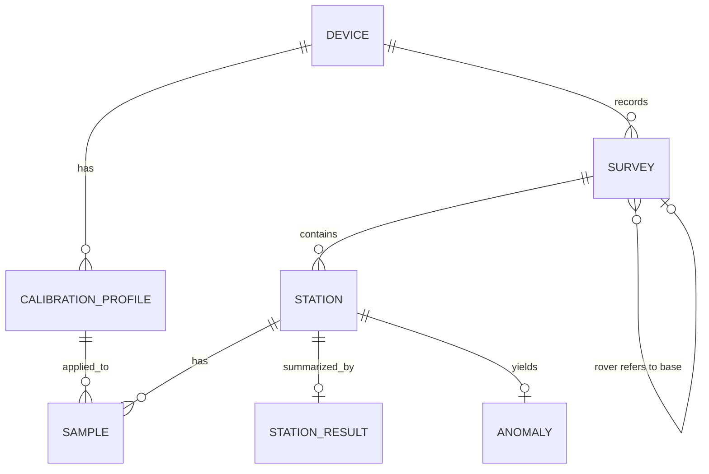

# ERD GeoMag (versi awal)

Satu survei punya banyak stasiun, satu stasiun punya banyak sampel, dan survei rover menunjuk ke survei base station yang direkam bersamaan. Parameter kalibrasi disimpan per perangkat dan dicatat pada setiap sampel supaya koreksi bisa diulang dari data mentah.

## Aturan data
Tabel Sample tidak pernah diubah atau dihapus. Anomaly dan StationResult adalah turunan yang boleh dihitung ulang.

## Diagram

## Entitas

| Entitas | Kolom utama | Relasi |
| --- | --- | --- |
| Device | id, model, versi Android, chip magnetometer, lantai noise (nT) | 1 Device punya banyak CalibrationProfile dan banyak Survey |
| CalibrationProfile | id, device_id, waktu, vektor hard iron b (3), matriks A (9), suhu, casing terpasang, residu (nT), berlaku sampai | Dipakai oleh banyak Sample |
| Survey | id, device_id, nama, tanggal, mode (rover atau base), catatan, base_survey_id | 1 Survey punya banyak Station; survei rover menunjuk survei base |
| Station | id, survey_id, urutan, lat, lon, akurasi GPS, x dan y lokal, tinggi sensor, arah pegang, catatan sekitar | 1 Station punya banyak Sample dan satu StationResult |
| Sample | id, station_id, calibration_id, timestamp (ns), nilai mentah x y z, bias OS x y z, suhu baterai, status charging, status layar | Milik satu Station |
| StationResult | station_id, rata-rata total field (nT), simpangan baku, jumlah sampel, diterima atau ditolak, alasan | Satu per Station |
| Anomaly | station_id, F_IGRF (nT), koreksi harian (nT), anomali delta T (nT) | Satu per Station, dihitung ulang dari data mentah |

Catatan: untuk survei mode base, Station boleh berupa satu titik acuan dengan banyak Sample sepanjang survei.
